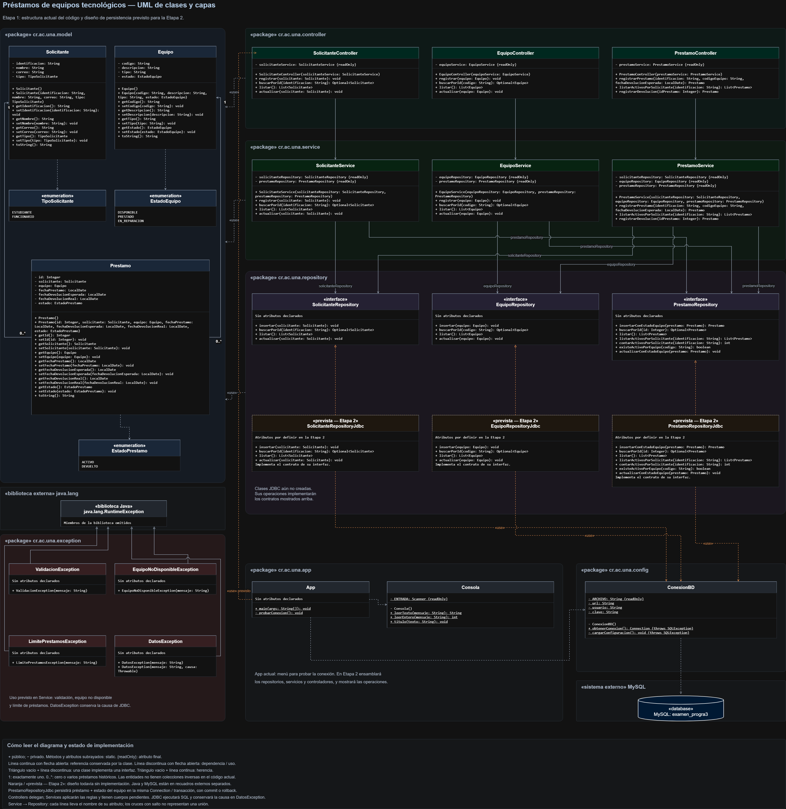
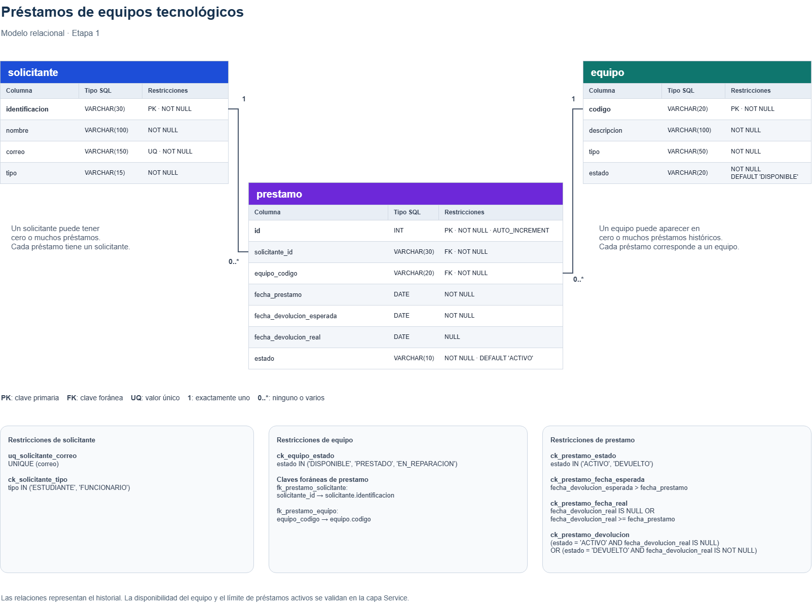

# Etapa 1 — Análisis, diseño y arquitectura

> Complete todas las secciones. Elimine las indicaciones entre `< >` al terminar.

## 9.1 Identificación

```text
Caso asignado: Caso 1. Préstamo de equipos tecnológicos
Integrante 1: John Perez Quesada
Integrante 2: Joe Sandoval Diaz
Integrante 3: Joshua Barrantes Granados
URL del repositorio: https://github.com/JohnPQ2312/examen1progra3
```

## 9.2 Descripción del problema

**Problema que se desea resolver:**

Actualmente se controlan los préstamos mediante una hoja de cálculo y se pueden prestar equipos que ya están prestados o en reparación. El sistema debe controlar disponibilidad y registrar los préstamos.

**Quién utilizaría el sistema:**

La persona encargada del área de préstamos de la unidad académica.

**Principales operaciones:**

- Registrar, consultar, listar y actualizar solicitantes y equipos; registrar préstamos; consultar préstamos activos de una persona; registrar devoluciones si las incorporamos al alcance.

## 9.3 Requerimientos funcionales

```text
RF-01. El sistema permitirá registrar solicitantes con su identificación, nombre, correo y tipo.
RF-02. El sistema permitirá consultar un solicitante por su identificación.
RF-03. El sistema permitirá listar los solicitantes registrados.
RF-04. El sistema permitirá actualizar el nombre, correo y tipo de un solicitante registrado.
RF-05. El sistema permitirá registrar equipos con su código, descripción, tipo y estado.
RF-06. El sistema permitirá consultar un equipo por su código.
RF-07. El sistema permitirá listar los equipos registrados.
RF-08. El sistema permitirá actualizar la información de un equipo, incluyendo su estado de reparación.
RF-09. El sistema permitirá registrar un préstamo asociado a un solicitante y un equipo, indicando la fecha del préstamo y la fecha esperada de devolución.
RF-10. El sistema permitirá consultar los préstamos activos de un solicitante, mostrando información del préstamo y del equipo mediante una consulta JOIN.
RF-11. El sistema permitirá registrar la devolución de un préstamo, guardar la fecha real de devolución y actualizar los estados del préstamo y del equipo.
```

## 9.4 Reglas de negocio

| ID | Regla | Operación donde se aplica | Qué ocurre si se viola |
|---|---|---|---|
| RN-01 | Solo se permite prestar un equipo en estado `DISPONIBLE`. Un equipo `PRESTADO` o `EN_REPARACION` no puede prestarse. | Registrar préstamo (RF-09). | Se rechaza con `EquipoNoDisponibleException`; no se registra el préstamo ni se cambia el estado del equipo. |
| RN-02 | Un estudiante puede tener como máximo 2 préstamos activos y un funcionario como máximo 4. Antes de registrar otro préstamo se verifica que no se haya alcanzado el límite; se cuentan únicamente los préstamos activos del solicitante. | Registrar préstamo (RF-09). | Se rechaza con `LimitePrestamosException`; no se registra un préstamo que exceda el límite. |
| RN-03 | La devolución cambia el préstamo a `DEVUELTO`, registra la fecha real de devolución y deja el equipo `DISPONIBLE`. Los cambios deben confirmarse juntos. | Registrar devolución (RF-11). | Si falla la persistencia, se revierte la operación completa y se informa mediante `DatosException`; no se confirma una devolución parcial. |
| RN-04 | No se permiten identificaciones de solicitantes ni códigos de equipos duplicados. | Registrar solicitante (RF-01) y registrar equipo (RF-05). | Se rechaza con `ValidacionException`; se conserva el registro existente y no se inserta el duplicado. |
| RN-05 | El solicitante y el equipo deben existir antes de registrar un préstamo. | Registrar préstamo (RF-09). | Se rechaza con `ValidacionException`, indicando cuál registro no existe; no se crea el préstamo. |
| RN-06 | La fecha esperada de devolución debe ser posterior a la fecha actual; no se acepta la fecha actual ni una anterior. | Registrar préstamo (RF-09). | Se rechaza con `ValidacionException`; se solicita una fecha válida y no se registra el préstamo. |
| RN-07 | Al registrar un préstamo, se crea en estado `ACTIVO` y el equipo cambia a `PRESTADO`. Ambas escrituras se realizan en una misma transacción. | Registrar préstamo (RF-09). | Si falla cualquiera de las escrituras, se revierte la transacción y se informa mediante `DatosException`; no se confirma un préstamo parcial. |
| RN-08 | Solo puede devolverse un préstamo existente y en estado `ACTIVO`; no se permite registrar su devolución dos veces. | Registrar devolución (RF-11). | Se rechaza con `ValidacionException`; se indica si el préstamo no existe o ya fue devuelto y se conservan sus datos actuales. |

## 9.5 Entidades, atributos y relaciones

| Clase | Responsabilidad | Atributos principales |
|---|---|---|
| `Solicitante` | Representar a la persona que solicita equipos y su categoría dentro de la unidad académica. | `identificacion: String`, `nombre: String`, `correo: String`, `tipo: TipoSolicitante`. |
| `Equipo` | Representar un equipo tecnológico y su estado de disponibilidad. | `codigo: String`, `descripcion: String`, `tipo: String`, `estado: EstadoEquipo`. |
| `Prestamo` | Representar una entrega de equipo a un solicitante, sus fechas y su estado, conservando el historial de la operación. | `id: Integer` (autogenerado al persistir), `solicitante: Solicitante`, `equipo: Equipo`, `fechaPrestamo: LocalDate`, `fechaDevolucionEsperada: LocalDate`, `fechaDevolucionReal: LocalDate` (nula mientras no se devuelva), `estado: EstadoPrestamo`. |

| Clases relacionadas | Tipo de relación | Multiplicidad | Explicación |
|---|---|---|---|
| `Solicitante` y `Prestamo` | Asociación. | `Solicitante 1 — 0..* Prestamo`. | Cada préstamo pertenece a un solicitante. Un solicitante puede tener cero o muchos préstamos históricos; sus préstamos activos están sujetos al límite de RN-02. |
| `Equipo` y `Prestamo` | Asociación. | `Equipo 1 — 0..* Prestamo`. | Cada préstamo corresponde a un equipo. Un equipo puede tener cero o muchos préstamos históricos, pero no se puede volver a prestar mientras esté `PRESTADO` (RN-01). |

**Enumeraciones:**

```java
public enum TipoSolicitante {
    ESTUDIANTE,
    FUNCIONARIO
}
```

```java
public enum EstadoEquipo {
    DISPONIBLE,
    PRESTADO,
    EN_REPARACION
}
```

```java
public enum EstadoPrestamo {
    ACTIVO,
    DEVUELTO
}
```

## 9.6 Diagrama de clases UML

Archivo: `docs/etapa_1/diagramas/uml.png` (o `.pdf`)



## 9.7 Modelo relacional

Archivo: `docs/etapa_1/diagramas/modelo_relacional.png` (o `.pdf`)



Script preliminar: [`database/schema.sql`](../../database/schema.sql)

## 9.8 Arquitectura propuesta

| Capa | Clases | Responsabilidad |
|---|---|---|
| `model` | `Solicitante`, `Equipo`, `Prestamo`, `TipoSolicitante`, `EstadoEquipo`, `EstadoPrestamo`. | Representar los datos, relaciones y estados del dominio. |
| `repository` | Interfaces `SolicitanteRepository`, `EquipoRepository`, `PrestamoRepository`; implementaciones previstas `SolicitanteRepositoryJdbc`, `EquipoRepositoryJdbc`, `PrestamoRepositoryJdbc`. | Definir contratos de persistencia y, en las implementaciones JDBC, ejecutar SQL parametrizado, mapear resultados y cerrar recursos. |
| `service` | `SolicitanteService`, `EquipoService`, `PrestamoService`. | Validar entradas y aplicar las reglas de negocio mediante interfaces de repositorios recibidas por constructor, sin SQL ni entrada/salida de consola. |
| `controller` | `SolicitanteController`, `EquipoController`, `PrestamoController`. | Recibir solicitudes, delegarlas al servicio correspondiente y devolver sus resultados, sin SQL ni reglas de negocio. |
| `exception` | `ValidacionException`, `EquipoNoDisponibleException`, `LimitePrestamosException`, `DatosException`. | Distinguir entradas inválidas, rechazos de negocio y fallos de persistencia; conservar la causa de los fallos de datos. |
| `app` | `App`, `Consola` (clases suministradas en la base). | Presentar el menú, leer entradas, mostrar resultados y errores, y ensamblar las dependencias del sistema. |
| `config` | `ConexionBD` (clase suministrada en la base). | Proporcionar conexiones JDBC a partir de la configuración local. |

**Interfaces Repository/DAO definidas:**

```java
package cr.ac.una.repository;

import cr.ac.una.model.Solicitante;
import java.util.List;
import java.util.Optional;

public interface SolicitanteRepository {
    void insertar(Solicitante solicitante);
    Optional<Solicitante> buscarPorId(String identificacion);
    List<Solicitante> listar();
    void actualizar(Solicitante solicitante);
}
```

```java
package cr.ac.una.repository;

import cr.ac.una.model.Equipo;
import java.util.List;
import java.util.Optional;

public interface EquipoRepository {
    void insertar(Equipo equipo);
    Optional<Equipo> buscarPorId(String codigo);
    List<Equipo> listar();
    void actualizar(Equipo equipo);
}
```

```java
package cr.ac.una.repository;

import cr.ac.una.model.Prestamo;
import java.util.List;
import java.util.Optional;

public interface PrestamoRepository {
    Prestamo insertarConEstadoEquipo(Prestamo prestamo);
    Optional<Prestamo> buscarPorId(Integer id);
    List<Prestamo> listar();
    List<Prestamo> listarActivosPorSolicitante(String identificacion);
    int contarActivosPorSolicitante(String identificacion);
    boolean existeActivoPorEquipo(String codigo);
    void actualizarConEstadoEquipo(Prestamo prestamo);
}
```

**Dependencias por constructor:**

| Clase | Dependencias |
|---|---|
| `SolicitanteService` | `SolicitanteRepository`, `PrestamoRepository`. |
| `EquipoService` | `EquipoRepository`, `PrestamoRepository`. |
| `PrestamoService` | `SolicitanteRepository`, `EquipoRepository`, `PrestamoRepository`. |
| `SolicitanteController` | `SolicitanteService`. |
| `EquipoController` | `EquipoService`. |
| `PrestamoController` | `PrestamoService`. |

**Operaciones previstas de servicios y controladores:**

Los controladores expondrán las mismas operaciones de su servicio y delegarán en él.

| Servicio y controlador | Firmas previstas | Requerimientos |
|---|---|---|
| `SolicitanteService` / `SolicitanteController` | `void registrar(Solicitante solicitante)`, `Optional<Solicitante> buscarPorId(String identificacion)`, `List<Solicitante> listar()`, `void actualizar(Solicitante solicitante)`. | RF-01 a RF-04. |
| `EquipoService` / `EquipoController` | `void registrar(Equipo equipo)`, `Optional<Equipo> buscarPorId(String codigo)`, `List<Equipo> listar()`, `void actualizar(Equipo equipo)`. | RF-05 a RF-08. |
| `PrestamoService` / `PrestamoController` | `Prestamo registrarPrestamo(String identificacion, String codigoEquipo, LocalDate fechaDevolucionEsperada)`, `List<Prestamo> listarActivosPorSolicitante(String identificacion)`, `Prestamo registrarDevolucion(Integer idPrestamo)`. | RF-09 a RF-11. |

**Coordinación de persistencia:** `PrestamoService` verificará las condiciones y preparará el préstamo y el estado de su equipo. `PrestamoRepositoryJdbc.insertarConEstadoEquipo(...)` guardará el préstamo y actualizará el equipo mediante una misma conexión y transacción; devolverá el préstamo con su id generado. `actualizarConEstadoEquipo(...)` persistirá conjuntamente la devolución y el estado del equipo. Los repositorios persistirán los valores decididos por el servicio y realizarán `commit` o `rollback` según el resultado de ambas escrituras. Su implementación JDBC corresponde a la Etapa 2.

## Código de la Etapa 1

- [ ] Clases del modelo (atributos privados, constructores, getters/setters, `toString()`).
- [ ] Enumeraciones.
- [ ] Interfaces `Repository`/`DAO`.
- [ ] Estructura de `Service` y `Controller`.
- [ ] Excepciones personalizadas.
- [ ] El proyecto compila.

## Distribución del trabajo

| Integrante | Aportes principales |
|---|---|
| | |
